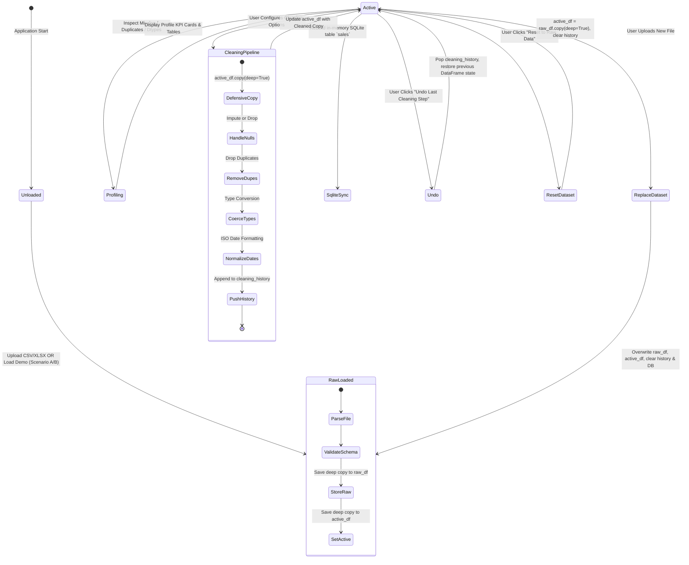

# Data Architecture & Data Flow — Sales Analytics Workbench

**SDLC Phase:** 3 — System Design (Checkpoint B)
**Document ID:** SDD-DATA
**Version:** 1.0

---

## 1. Overview

This document defines the complete dataset lifecycle, state management, immutability contracts, defensive copying boundaries, cleaning history tracking, undo/reset semantics, and date handling rules.

---

## 2. Dataset State Management & Immutability Contracts

Pandas DataFrames are mutable objects in memory. To guarantee **NFR-R-02 (Data Integrity: original data never mutated)** and prevent unintended side effects across modules, the application enforces strict defensive copying boundaries within `st.session_state`.

### 2.1 State Variables in `st.session_state`

| State Key | Type | Responsibility | Mutation Rule |
|---|---|---|---|
| `st.session_state['raw_df']` | `pd.DataFrame` | Immutable snapshot of the parsed input dataset immediately after upload or demo load. | **Read-only**. Never modified by any service or UI action. |
| `st.session_state['active_df']` | `pd.DataFrame` | Current working DataFrame consumed by EDA, SQL analysis, and statistical testing. | Updated only when cleaning steps are applied or datasets are reset. |
| `st.session_state['cleaning_history']` | `list[dict]` | Ordered stack of applied cleaning operations (action type, columns affected, rows removed/imputed). | Appended on clean; popped on undo; cleared on reset/replace. |
| `st.session_state['column_mapping']` | `dict` | Maps user-uploaded column names to canonical schema columns (FR-CC-02). | Updated via column mapping UI. |
| `st.session_state['db_conn']` | `sqlite3.Connection` | Active in-memory SQLite connection handle pointing to table `sales`. | Re-created on dataset load/clean/reset. |

---

## 3. Dataset Lifecycle & State Transitions

---

## 4. Undo vs. Reset Semantics

- **Undo:** Pops the most recent operation from `st.session_state['cleaning_history']` and restores `active_df` to the state it was in before that specific operation was applied. If the history stack is empty, the undo button is disabled.
- **Reset ("Reset to Raw Data"):** Discards all cleaning steps, restores `active_df = st.session_state['raw_df'].copy(deep=True)`, clears `st.session_state['cleaning_history']`, and rebuilds the SQLite database from the raw dataset.
- **Dataset Replacement:** When a new file is uploaded or a different mode (Upload vs. Internship Dataset) is selected, `raw_df`, `active_df`, `cleaning_history`, and `db_conn` are completely torn down and re-initialized.

---

## 5. Date Normalization & Invalid Date Handling (Query 5 Protection)

To satisfy the requirements for SQL Query 5 (`STRFTIME('%Y-%m', Order_Date)`) without silently discarding user data:

1. **Parsing:** During data loading and date cleaning, `Order_Date` is parsed using `pd.to_datetime(series, errors='coerce')`.
2. **Classification:**
   - **Valid Dates:** Successfully parsed into datetime objects and stored in SQLite as ISO-8601 strings (`YYYY-MM-DD`).
   - **Invalid / Unparseable Dates:** Converted to `NULL` (None) in the SQLite database rather than crashing the query or silently deleting the entire row.
3. **Reporting:** The cleaning summary explicitly reports:
   - Total rows with valid dates.
   - Total rows with invalid/unparseable dates.
   - Total revenue associated with valid-date rows vs. invalid-date rows.
4. **Query 5 Behavior:** When SQLite executes `STRFTIME('%Y-%m', Order_Date)` on `NULL` dates, the result is `NULL`. In Module 2's monthly revenue chart, `NULL` months are grouped into an explicit `[Unspecified / Invalid Date]` category (or omitted with a clear explanatory callout), ensuring revenue transparency while preserving the integrity of the monthly trend for valid transactions.

---

## 6. Flexible Column Mapping (FR-CC-02)

When a user uploads a custom dataset whose column names differ from the internship schema (`Order_ID`, `Order_Date`, `Customer_ID`, `Customer_Name`, `Age`, `Gender`, `City`, `Product`, `Category`, `Quantity`, `Unit_Price`, `Total_Sales`):

1. **Auto-Detection:** The system performs fuzzy matching against expected column names (e.g., matching "cust_id" or "client_id" to `Customer_ID`).
2. **Interactive Mapping UI:** If required columns are unmapped, Module 1 renders a mapping interface where the user assigns their CSV/XLSX columns to the canonical schema.
3. **Validation Check:** At minimum, one numeric column representing sales/revenue and one categorical/date column must be successfully mapped or analysis execution is blocked with a clear error banner.
