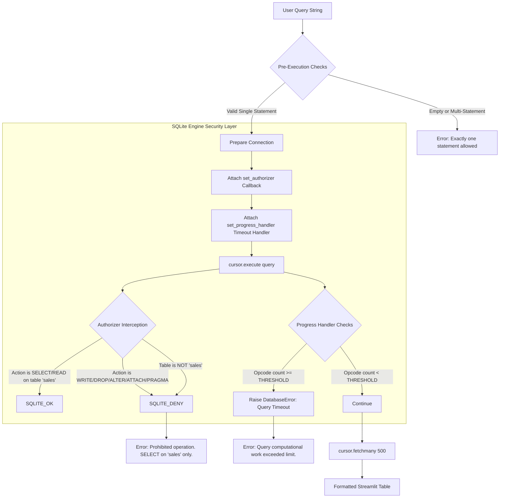

# Database and SQL Architecture — Sales Analytics Workbench

**SDLC Phase:** 3 — System Design (Checkpoint B)
**Document ID:** SDD-DB-SQL
**Version:** 1.0

---

## 1. Overview

This document specifies the SQLite database lifecycle, schema validation, data ingestion pipeline, engine-level security architecture, and the execution rules for the seven approved business queries.

---

## 2. In-Memory SQLite Connection Lifecycle

### 2.1 Session Isolation & Concurrency
- **Isolated In-Memory Instance:** Each browser session receives an isolated in-memory database (`:memory:`). User A's uploaded dataset never collides with or leaks into User B's session.
- **Connection Storage:** The SQLite connection object is stored in `st.session_state['db_conn']`.
- **Threading Model & `check_same_thread=False`:** Streamlit's architecture handles HTTP interactions asynchronously across a worker thread pool. Different script runs of the same user session may execute on different worker threads. Consequently, `sqlite3.connect(':memory:', check_same_thread=False)` is technically mandatory to prevent `sqlite3.ProgrammingError: SQLite objects created in a thread can only be used in that same thread`.
- **Serialization:** Because Streamlit executes page scripts sequentially per session, operations on the connection are inherently serialized.

### 2.2 Rebuild & Cleanup Sequence
Whenever `active_df` is modified (via upload, cleaning, undo, or reset):
1. **Close Existing Connection:** If an existing connection exists in `st.session_state['db_conn']`, it is closed cleanly to release memory.
2. **Open New Connection:** A fresh `:memory:` connection is created.
3. **Ingest Trusted Data:** The `active_df` is ingested into table `sales` via `df.to_sql('sales', conn, if_exists='replace', index=False)`.
4. **Attach Security Authorizer:** The engine-level authorizer callback is attached **after** ingestion completes, ensuring ingestion succeeds while user queries are strictly constrained.
5. **Attach Progress Handler:** A progress handler is registered to enforce query timeouts.

---

## 3. SQLite Schema & Type Mappings

To prevent ingestion failures on arbitrary uploaded datasets (which might contain duplicate IDs or missing values):

```sql
CREATE TABLE sales (
    Order_ID        TEXT,            -- Nullable, non-unique (supports custom uploads)
    Order_Date      TEXT,            -- Normalized ISO YYYY-MM-DD or NULL
    Customer_ID     TEXT,            -- Nullable
    Customer_Name   TEXT,            -- Nullable
    Age             REAL,            -- Nullable numeric
    Gender          TEXT,            -- Nullable ('Male', 'Female', etc.)
    City            TEXT,            -- Nullable
    Product         TEXT,            -- Nullable
    Category        TEXT,            -- Nullable
    Quantity        INTEGER,         -- Numeric (defaults to 0 if null)
    Unit_Price      REAL,            -- Numeric
    Total_Sales     REAL             -- Numeric
);
```

*Design Rationale:* Constraints like `PRIMARY KEY` or `NOT NULL` are not enforced at the SQLite engine level because uploaded datasets may be imperfect before cleaning. Business rule validations are performed in the Service Layer (`validator.py`), not as database constraints that would abort ingestion.

---

## 4. Engine-Level SQL Security Architecture

In accordance with approved decision D-3, security is enforced at the SQLite engine layer using Python's native `sqlite3.Connection.set_authorizer` and `set_progress_handler`.



### 4.1 Authorizer Specification (`authorizer.py`)
The authorizer callback receives `(action_code, param1, param2, db_name, trigger_name)`:
- **Allowed Action Codes:**
  - `SQLITE_SELECT`
  - `SQLITE_READ` (permitted only when `param1 == 'sales'`)
  - `SQLITE_FUNCTION` (permitted for standard SQL functions: `SUM`, `AVG`, `COUNT`, `MIN`, `MAX`, `ROUND`, `STRFTIME`, `LOWER`, `UPPER`, `COALESCE`)
- **Prohibited Action Codes (Returning `SQLITE_DENY`):**
  - `SQLITE_INSERT`, `SQLITE_UPDATE`, `SQLITE_DELETE`
  - `SQLITE_CREATE_TABLE`, `SQLITE_DROP_TABLE`, `SQLITE_ALTER_TABLE`
  - `SQLITE_ATTACH`, `SQLITE_DETACH`
  - `SQLITE_PRAGMA`
  - Any read on internal tables (`sqlite_master`, `sqlite_temp_master`, `sqlite_schema`).

### 4.2 Computational Work & Execution-Time Limits
- **Progress Handler (`set_progress_handler`):** A callback is invoked every `N` SQLite virtual machine opcodes (e.g., every 5,000 instructions). If total elapsed execution time exceeds **2.0 seconds** or opcode count exceeds **1,000,000 instructions**, the callback returns non-zero, immediately aborting the query with `sqlite3.OperationalError: interrupted`.
- **Result-Row Limit:** Results are retrieved via `cursor.fetchmany(500)`. If more than 500 rows match, a warning indicator is displayed: *"Showing first 500 rows. Refine your query with WHERE or LIMIT for targeted analysis."*

---

## 5. Seven Approved Business Queries

All seven queries operate on the canonical lowercase `sales` table:

| # | Query Title | SQL Query | Business Question |
|---|---|---|---|
| **1** | Total Revenue | `SELECT SUM(Total_Sales) AS Total_Revenue FROM sales;` | What is the total revenue across all sales? |
| **2** | Revenue by Category | `SELECT Category, SUM(Total_Sales) AS Revenue FROM sales GROUP BY Category ORDER BY Revenue DESC;` | Which product categories generate the most revenue? |
| **3** | Revenue by Product | `SELECT Product, SUM(Total_Sales) AS Revenue FROM sales GROUP BY Product ORDER BY Revenue DESC;` | Which individual products generate the most revenue? |
| **4** | Revenue by City | `SELECT City, SUM(Total_Sales) AS Revenue FROM sales GROUP BY City ORDER BY Revenue DESC;` | Which cities contribute the most to revenue? |
| **5** | Monthly Revenue Trend | `SELECT STRFTIME('%Y-%m', Order_Date) AS Month, SUM(Total_Sales) AS Revenue FROM sales GROUP BY Month ORDER BY Month;` | What is the monthly revenue trend (seasonality) throughout the year? |
| **6** | Revenue Split by Gender | `SELECT Gender, SUM(Total_Sales) AS Revenue FROM sales GROUP BY Gender;` | How does revenue split by gender? |
| **7** | Top 10 Customers | `SELECT Customer_Name, SUM(Total_Sales) AS Revenue FROM sales GROUP BY Customer_Name ORDER BY Revenue DESC LIMIT 10;` | Who are the top-10 customers by revenue? |
