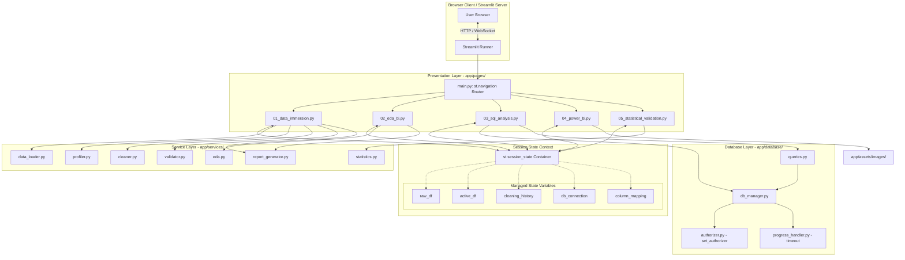

# System Architecture — Sales Analytics Workbench

**SDLC Phase:** 3 — System Design (Checkpoint B)
**Document ID:** SDD-ARCH
**Version:** 1.0

---

## 1. Architectural Overview

The **Sales Analytics Workbench** is architected as a modular, layered local data analytics web application built with Python and Streamlit. The architecture strictly enforces **Separation of Concerns (SoC)** across four distinct layers:

1. **Presentation Layer (Streamlit UI):** Renders interactive pages, widgets, KPI cards, and charts. Contains zero business logic or raw SQL execution.
2. **Session State & Context Management Layer:** Manages application state, dataset lifecycle (`raw_df`, `active_df`), cleaning history, and in-memory database handles.
3. **Service & Domain Logic Layer (Pure Python):** Implements data loading, profiling, cleaning, validation, EDA aggregation, and Welch's t-test calculation. Completely decoupled from Streamlit UI (`st.*`), making services 100% unit-testable via `pytest`.
4. **Database & SQL Engine Layer:** Manages an in-memory SQLite database instance with strict engine-level security (SELECT-only authorizer, progress handler limits, and read-only table isolation).

---

## 2. Architectural Layers & Responsibilities

| Layer | Components / Modules | Responsibility | Dependencies |
|---|---|---|---|
| **Presentation** | `app/main.py`, `app/pages/*.py`, `app/components/*.py` | Renders UI navigation, layouts, data tables, and Plotly charts. Collects user parameters. | Streamlit, Plotly, Service Layer |
| **State Context** | `st.session_state` | Maintains session isolation, raw/active DataFrames, undo/reset stacks, and DB connections. | Streamlit |
| **Service Logic** | `app/services/*.py`, `app/models/*.py` | Implements data processing pipelines, statistics, data validation, and report exports. | pandas, NumPy, SciPy, openpyxl |
| **Database** | `app/database/*.py` | Manages SQLite in-memory lifecycle, schema creation, registration, and authorizer security. | Python `sqlite3` |
| **Utilities** | `app/utils/*.py` | Cross-cutting concerns: dark theme CSS injection, Plotly figure templates, currency formatting. | Streamlit, Plotly |

---

## 3. System Architecture Diagram

---

## 4. Data Flow Between Layers

1. **User Action:** User uploads a CSV/XLSX file or selects Internship Dataset Mode on Page 1 (`01_data_immersion.py`).
2. **Service Execution:** `data_loader.py` parses the file, validates extensions, and returns a raw DataFrame.
3. **State Mutation (Controlled):** A deep copy is stored as `st.session_state['raw_df']`, and another copy as `st.session_state['active_df']`.
4. **Profiling & Cleaning:** `profiler.py` analyzes missing values and duplicates. User applies cleaning options via `cleaner.py`, which produces a new DataFrame copy, pushes the action to `cleaning_history`, and updates `active_df`.
5. **Database Sync:** Whenever `active_df` changes, `db_manager.py` tears down the old in-memory SQLite connection, creates a fresh connection, registers `active_df` into table `sales`, and attaches the SELECT-only authorizer and progress handler.
6. **Analytics & SQL:** EDA charts consume `active_df` directly. SQL queries execute against the secure SQLite in-memory database via `queries.py`. Statistical tests compute directly on `active_df` via `statistics.py`.
7. **Rendering:** Results are formatted via `formatters.py` and rendered using Streamlit widgets and Plotly charts styled via `styling.py` and `charts.py`.

---

## 5. Traceability to Requirements

- **FR-01 through FR-20:** Covered across the presentation pages and service modules.
- **NFR-U-01, NFR-U-02:** Addressed by native `st.navigation` and centralized styling.
- **NFR-M-01:** Enforced through strict modular separation (`app/pages/`, `app/services/`, `app/database/`, `app/utils/`).
- **NFR-R-02:** Enforced through session state immutability contracts (`raw_df` vs `active_df`).
