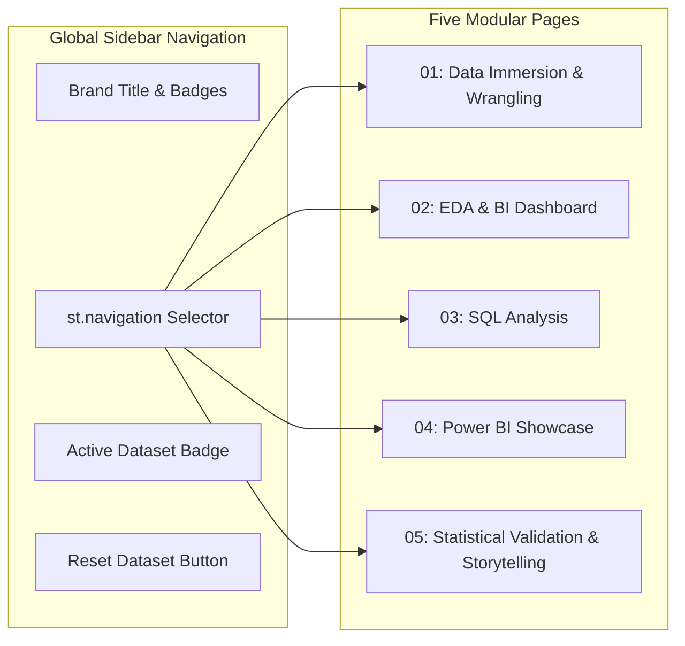

# UI/UX & Interaction Design — Sales Analytics Workbench

**SDLC Phase:** 3 — System Design (Checkpoint B)
**Document ID:** SDD-UI-UX
**Version:** 1.0

---

## 1. Design Philosophy & Visual Identity

The **Sales Analytics Workbench** UI is designed as an **Executive Analytics Product** rather than a typical student script. It uses a **Dark Navy & Blue Design Language** with high contrast (WCAG AA compliant), clear typographic hierarchy, clean data density, and native responsive Streamlit layouts.

---

## 2. Color Palette & Theming System

```
[ Primary Background: Deep Midnight Navy #0B132B ]
     ├── [ Card / Container Background: Slate Navy #1C2541 ]
     │        ├── [ Surface Header / Table Header: Cobalt Surface #223055 ]
     │        └── [ Accent Highlight: Royal Blue #4F86F7 & Vivid Cyan #00F5D4 ]
     └── [ Typography: Primary White #F8FAFC | Muted Slate #94A3B8 ]
```

| Token | Hex Value | Usage / Component |
|---|---|---|
| `--bg-main` | `#0B132B` | Full page background |
| `--bg-card` | `#1C2541` | Metric cards, chart containers, query boxes |
| `--bg-surface` | `#223055` | Table headers, dropdown backgrounds, active pills |
| `--border-subtle`| `#2D3B60` | Container outlines and card dividers |
| `--accent-blue` | `#4F86F7` | Primary buttons, active navigation, trend lines |
| `--accent-cyan` | `#00F5D4` | Secondary charts, key KPI value highlights |
| `--text-primary`| `#F8FAFC` | Headings (H1-H3), metric values, table data |
| `--text-muted`  | `#94A3B8` | Field labels, captions, footnotes, axis labels |
| `--status-success`| `#10B981` | Validation pass badge, cleaned confirmation |
| `--status-warning`| `#F59E0B` | Missing values detected, duplicate warnings |
| `--status-danger` | `#EF4444` | Security denial, invalid query, error banners |

---

## 3. Typography & Hierarchy

- **Font Family:** System Sans-serif fallback (`Segoe UI`, `Roboto`, `Helvetica Neue`, `sans-serif`).
- **H1 (Page Titles):** 28px, Bold (`#F8FAFC`), accompanied by a sub-header module description.
- **H2 (Section Headers):** 20px, Semi-Bold (`#F8FAFC`), bordered bottom divider.
- **H3 (Card / Chart Titles):** 16px, Medium (`#94A3B8`).
- **KPI Metrics:** 32px, Bold (`#00F5D4` or `#4F86F7`).
- **Body & Captions:** 14px Regular (`#F8FAFC` body, `#94A3B8` caption).

---

## 4. Navigation Architecture & Sidebar

Navigation uses native Streamlit `st.navigation` declared in `app/main.py`:



---

## 5. Page Layout Specifications

### 5.1 Page 1: Data Immersion & Wrangling
- **Top Bar:** Radio toggle: `[Upload CSV/XLSX]` vs `[Internship Dataset Mode]` vs `[Synthetic Demo]`.
- **Row 1 (Overview KPIs):** Total Rows, Total Columns, Total Missing Values, Duplicate Rows Count.
- **Row 2 (Tabs):**
  - *Tab 1 (Data Preview):* First N rows slider (5–100), full schema column inspector.
  - *Tab 2 (Data Profiling):* Missing value distribution table, data type flags.
  - *Tab 3 (Cleaning Pipeline):* Configurable actions (impute strategy per column, drop duplicates toggle, date format coercion) + `[Execute Cleaning]` button.
  - *Tab 4 (Validation & Export):* Business rule pass/fail cards, export to CSV/XLSX download buttons.

### 5.2 Page 2: Exploratory Data Analysis & BI Dashboard
- **Top Row (Executive KPIs):** Total Revenue, Total Orders, Average Order Value (AOV), Total Quantity Sold.
- **Chart Grid (Plotly Dark Native):**
  - *Chart 1 (Bar):* Revenue by Category.
  - *Chart 2 (Line):* Monthly Revenue Trend.
  - *Chart 3 (Horizontal Bar):* Revenue by City (Patna highlighted).
  - *Chart 4 (Heatmap):* Numerical Correlation Matrix (`Unit_Price` vs `Total_Sales` r=0.686 highlighted).

### 5.3 Page 3: SQL Business Queries
- **Top Section:** Pre-built query dropdown (Queries 1–7) with business question narrative badge.
- **Query Editor Area:** Code box displaying current SQL + Run Query button.
- **Custom SQL Console:** Expandable container for user-typed `SELECT` statements with security disclaimer.
- **Results Table:** Paginated dataframe with row counter, execution time badge, and CSV download.

### 5.4 Page 4: Power BI Dashboard Showcase
- **Top Banner:** Authentic deliverable disclaimer (Power BI is a distinct desktop deliverable; screenshots shown for evaluation).
- **Screenshot Viewer:** High-resolution dashboard screenshot with interactive zoom.
- **DAX Measure Cards:** 6 interactive cards revealing DAX formula, return type, and business rationale.
- **Slicers & Visuals Breakdown:** Grid documenting the 4 slicers and 6 dynamic visualizations.

### 5.5 Page 5: Statistical Validation & Data Storytelling
- **Hypothesis Formulation Card:** Formal statement of $H_0$ and $H_1$, two-tailed test, $\alpha = 0.05$.
- **Statistical Results Banner:**
  - Metric cards: t-statistic (`0.683`), p-value (`0.495`), Mean Difference (`₹4,924.13`), 95% CI.
  - Decision Badge: Green pill: **Fail to Reject $H_0$ (p = 0.495 > 0.05)**.
- **Distribution Plot:** Plotly overlay of Male vs. Female sales distributions with CI error bars.
- **Storytelling Section:** Structured business recommendations, 5-task summary, GitHub repo cards.

---

## 6. Feedback & Interaction States

| State | Visual Treatment | Example |
|---|---|---|
| **Loading** | Streamlit spinner with pulse effect | *"Ingesting dataset into SQLite database..."* |
| **Success** | Green banner (`#10B981`) with checkmark | *"Dataset cleaned: 0 missing values, 0 duplicates."* |
| **Warning** | Amber callout (`#F59E0B`) | *"Showing first 500 rows. Query truncated for display."* |
| **Error** | Red callout (`#EF4444`) with actionable fix | *"Security Violation: Write operations are prohibited."* |
| **Empty State** | Centered muted container with prompt | *"No dataset loaded. Upload a file or enable Demo Mode."* |
